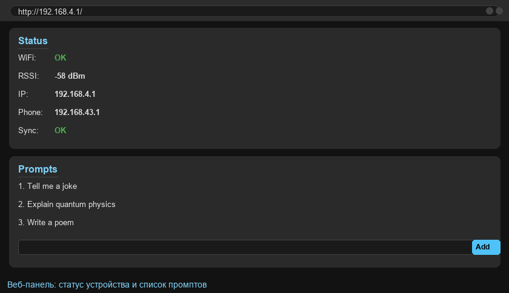
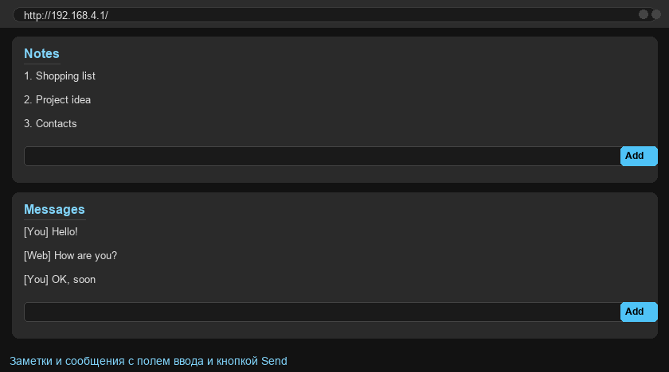
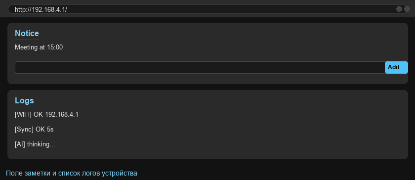

# ESP8266 AI Terminal


A smart OLED terminal based on the **ESP8266** with games, a built-in AI chat, clock, calculator, notes, and messages. The whole device is controlled with just two buttons and renders its interface on a 128×64 monochrome OLED — like a tiny wearable computer.

The project is made up of three parts:

- **ESP8266 firmware** (`8.6.ino`) — all device code: UI, games, sync, web server.
- **Control Panel** (`control_panel/app.py`) — a PC web panel that stores data for all devices and provides **AI answers through Ollama**.
- **Phone Relay** (`phone_relay/relay_server.py`) — a relay for an Android phone (Termux) that connects the ESP to the Control Panel over the internet.

```
┌────────────┐   WiFi (phone hotspot)      ┌────────────┐   internet   ┌────────────────┐
│   ESP8266   │ ◀─────────────────────────▶ │  Phone     │ ◀──────────▶ │ Control Panel  │
│  (8.6.ino)  │           /api/state        │  Relay     │  (Tailscale) │  (app.py)      │
└────────────┘                               └────────────┘              └────────────────┘
                                              port 8000                    Flask + Ollama
```

> **How it works, briefly.** The ESP connects to your phone's hotspot and talks to the relay app over the local network. The relay forwards data to the external Control Panel and back. An AI prompt typed on the ESP reaches the Control Panel, which sends it to a local Ollama model and returns the answer. The ESP then renders the answer on screen.

---

## Features

- **AI chat** — type a prompt on the device, get an answer from a local neural network (Ollama) displayed with page scrolling.
- **Main menu** — 8 items with a configurable order: AI Chat, Time, Notice, Maps, Calc, Msg, Notes, Games.
- **Clock** — time synchronized over NTP (requires internet).
- **Calculator** — basic operations (`+ - * /`) entered with the two buttons.
- **Messages and notes** — character-by-character entry, ready-made templates, history, sync with the panel.
- **Three games**: Pong (vs an AI paddle), Dodger (dodging blocks), Dino (running dinosaur).
- **On-screen notice** — leave yourself a reminder.
- **Loadable maps** — a list and viewer for binary maps (demo mechanism).
- **Built-in web panel** — manage prompts, notes, and messages straight from a browser.
- **Sleep mode** — turns the display off and saves battery (see "Battery usage" section).
- **Settings**: menu order, brightness, notifications, sleep, sync, WiFi connection.

---

## Not supported / current limitations

- Color OLED is not supported — it uses a monochrome SSD1306 128×64.
- The on-device keyboard only enters **latin letters (A–Z) and digits**; Cyrillic cannot be typed on the device itself.
- AI answers are truncated and split into pages of 5 lines because of the small screen.
- AI requires a running Ollama plus network access to it through the relay.

---

## Hardware requirements

| Component | Recommendation |
|---|---|
| **ESP8266** | NodeMCU or Wemos D1 mini, 4 MB flash |
| **OLED** | SSD1306, 128×64, 4-wire **SPI** |
| **Buttons** | 2 pieces, pulled to GND (INPUT_PULLUP is used) |
| **Power** | 3.3 V (via USB or a Li-Po battery through an LDO) |

### OLED wiring (SPI)

| SSD1306 pin | ESP8266 pin | GPIO |
|---|---|---|
| SCL (SCK) | D5 | GPIO14 |
| SDA (MOSI) | D7 | GPIO13 |
| CS | D8 | GPIO15 |
| DC | D2 | GPIO4 |
| RST | D0 | GPIO16 |
| VCC | 3.3V | — |
| GND | GND | — |

> Always double-check the pinout against your actual board — some NodeMCU clones differ.

---

## Flashing the firmware (8.6.ino)

1. Install **Arduino IDE** (1.8+ or 2.x).
2. Add the **ESP8266** board package:
   - File → Preferences → *Additional Boards Manager URLs*:
     `http://arduino.esp8266.com/stable/package_esp8266com_index.json`
   - Tools → Board → Boards Manager → search **esp8266** → Install.
3. Via **Library Manager** (Tools → Manage Libraries) install:
   - `U8g2`
   - `ArduinoJson`
   - `ESP8266WiFi`, `ESP8266HTTPClient`, `ESP8266WebServer` (bundled with the ESP8266 package)
4. Open `8.6.ino` and **fill in your own values** in the block at the top of the file — placeholders are provided right now:

```cpp
const char* PHONE_RELAY_FALLBACK = "192.168.0.100";  // relay (phone) IP
const char* FALLBACK_SSID = "YOUR_WIFI_SSID";        // fallback home WiFi
const char* FALLBACK_PASS = "";                      // password (empty = open network)
```

   At minimum set `FALLBACK_SSID`/`FALLBACK_PASS`. `PHONE_RELAY_FALLBACK` is used when the ESP cannot auto-detect the phone's IP.
5. Select the board: **Tools → Board → NodeMCU 1.0 (ESP-12E Module)** with **4MB** flash size.
6. Connect the board and click **Upload**.

> The firmware stores settings, prompts, notes, and messages in **SPIFFS (LittleFS)**. Data survives reboots and, on the very first boot, default prompts appear — your later edits are never overwritten.

---

## Button controls

| Action | Button |
|---|---|
| Scroll / switch item | **NEXT** (short tap) |
| Select / enter item | **SEND** (short tap) |
| Extra action (e.g. send an AI prompt) | **NEXT** (hold) |
| Back / return to menu | **SEND** (hold) |
| Open settings (from the menu) | **SEND** (hold) |
| Toggle sleep mode | **NEXT + SEND** (hold together) |

**In the Dino game:** `SEND` — jump, `NEXT` — duck, hold — pause.
**In the calculator:** `NEXT` — change digit/operator, `SEND` — enter, hold `NEXT` — `=`, hold `SEND` — reset and exit.

---

## Battery usage

Power the device from one or two **Li-Po / Li-Ion cells** via an LDO 3.3 V regulator, or from a USB power bank. Below are approximate run-times for different capacities.

**Assumptions:**
- average consumption **≈ 75 mA** with the display on;
- consumption in sleep mode **≈ 10 mA** (display off, WiFi sleeping);
- "mixed scenario" — about 3 hours on-screen and 21 hours sleeping in every 24 h;
- "active mode" — display always on;
- "sleep" — display almost always off.

| Capacity | Active mode, ~75 mA | Sleep, ~10 mA | Mixed, ~18 mA* |
|---|---|---|---|
| **300 mAh** | ~4 h | ~30 h | ~16 h |
| **400 mAh** | ~5 h | ~40 h | ~22 h |
| **500 mAh** | ~6.5 h | ~50 h | ~27 h |
| **1000 mAh** | ~13 h | ~100 h (~4 days) | ~55 h (~2.3 days) |

\* Mixed scenario: display on about 3 h/day, the rest of the time in sleep.

**Ways to extend battery life:**
- enable **Sleep mode** (Settings → Sleep) in the menu;
- lower the **brightness** (Settings → Bright) — display power drops noticeably;
- use a **1000 mAh cell** if the device runs for long periods.

---

## Control Panel (control_panel/app.py)

The web panel stores every device's data in JSON files and provides **AI answers through local Ollama**.

### Requirements

- Python 3.8+
- Installed and running [**Ollama**](https://ollama.com)
- A downloaded model (for example `deepseek-r1:1.5b`, the default used here)

### Install and run

```bash
cd control_panel
pip install -r requirements.txt
python app.py
```

The panel comes up at `http://0.0.0.0:5000`. Open it in a browser on the same computer.

### Configure before running

In `control_panel/app.py`:

```python
OLLAMA_MODEL = "deepseek-r1:1.5b"      # model you pulled into Ollama
SYSTEM_PROMPT = "You must answer ONLY in English. Be brief and clear."
API_TOKEN = "CHANGE_ME_RANDOM_SECRET_TOKEN"   # set your own secret string
```

`API_TOKEN` is shared across the whole system. The same token must be set in `app.py`, `relay_server.py`, and `templates/index.html`.

### Exposing it to the internet

To let the relay on your phone reach the Control Panel, open network access to it. The simplest way is a Tailscale tunnel:

```bash
tailscale funnel 5000
```

Put the resulting public address into `relay_server.py` (the `PUBLIC_CONTROL_PANEL` field).

---

## Phone Relay (phone_relay/relay_server.py)

The relay runs on an **Android phone inside Termux** and bridges the ESP to the Control Panel over the internet. It acts as a local gateway: it receives data from the ESP over WiFi (port 8000), forwards it to the Control Panel and back, and also serves a small web UI for editing data from the phone.

### Configure before running

In `phone_relay/relay_server.py`:

```python
PUBLIC_CONTROL_PANEL = "https://YOUR_PUBLIC_CONTROL_PANEL_URL"
API_TOKEN = "CHANGE_ME_RANDOM_SECRET_TOKEN"
```

- `PUBLIC_CONTROL_PANEL` — the address where the Control Panel is reachable (see above);
- `API_TOKEN` — the same as in `app.py`.

### Run in Termux

```bash
cd phone_relay
chmod +x start_relay.sh
./start_relay.sh        # installs dependencies and runs relay_server.py
```

Or manually:

```bash
cd phone_relay
pip install -r requirements.txt
python relay_server.py
```

After startup the local web UI is available on the phone at the address printed to the console (usually `http://192.168.43.1:8000`).

---

## ESP built-in web panel

In addition to the PC panel, the ESP itself has a small web UI baked straight into the firmware and served from any browser. It's a regular web page running on the device that collects all terminal data into one dark dashboard page.

### How to open it

1. Find the terminal IP (the **Stats** menu on screen, the `IP:` line).
2. Open `http://<IP>/` in a browser (by default `http://192.168.4.1/`).

No installation needed: the page and all data live inside the firmware. The interface refreshes automatically every 3 seconds.

### What's on the page

The web panel is made of six sections combined into a single page:

| Section | Purpose |
|---|---|
| **Status** | Current device state: WiFi status, signal strength (RSSI), terminal IP, relay address, and the last sync result (OK/FAIL). |
| **Prompts** | List of AI prompts with a counter. Each can be edited (**Save**) or removed (**Del**). The **New prompt** field + **Add** button adds a new prompt (up to 60 chars). |
| **Notes** | Device notes. Each can be renamed (Save) or deleted (Del). **Clear** removes all notes at once. |
| **Messages** | Device message log. `[Y]` marks messages sent from the terminal, `[W]` those coming from the web panel. The field + **Send** button sends a message to the device. |
| **Notice** | The notice text shown on the terminal's screen (the **Notice** menu item). The field + **Set** button saves it and shows it on the OLED. |
| **Logs** | Firmware system log (WiFi connections, sync, errors). A live list that refreshes automatically. |

### Interface screenshots

The dark theme and blue buttons echo the OLED terminal's style. Below is how the panel looks in a browser.

**Device status info and the prompts list:**



**Notes and the message history:**



**On-screen notice and system logs:**



> These images are generated by the [`simulator_web_ui.py`](#web-panel-simulator-simulator_web_uipy) script and stored in the `screenshots/web/` folder. The real panel looks the same but shows your device's actual data.

### Fast data navigation

Any change you make in the web panel (prompts, notes, messages, notice) is pushed to the terminal on the next sync cycle and shows up on the OLED within a few seconds.

---

## Data sync

Every ~5 seconds the ESP sends its data — prompts, notes, messages — to the relay and pulls updated versions back. This lets you edit data from both the web panel and the phone.

Sync is controlled in the **Settings → Sync** menu. The last sync status is visible in the **Stats** menu.

---

## Screen simulator (simulator_oled.py)

**You don't need hardware to preview the interface.** The `simulator_oled.py` script renders an exact 128×64 OLED screen for every key state of the firmware and saves them as PNG files into the **`screenshots/`** folder.

Useful for: documentation, menu design, demos, layout checks without flashing.

### Run

You need **Python 3.8+** and the **Pillow** library.

```bash
pip install pillow
python simulator_oled.py
```

The script creates (or overwrites) the `screenshots/` folder and generates 20 images:

| File | What it shows |
|---|---|
| `01_splash.png` | Boot splash screen + progress bar |
| `02_menu.png` | Main menu |
| `03_stats.png` | Status: WiFi, RSSI, IP, sync |
| `04_ai_list.png` | AI prompt list |
| `05_thinking.png` | "AI thinking" |
| `06_response.png` | AI answer, one of several pages |
| `07_time.png` | Clock |
| `08_notice.png` | Notice |
| `09_maps.png` | Maps list |
| `10_settings.png` | Settings |
| `11_wifi_list.png` | WiFi scan |
| `12_calc.png` | Calculator |
| `13_chat.png` | Messages |
| `14_notes.png` | Notes |
| `15_games.png` | Games menu |
| `16_pong.png` | Pong game |
| `17_dino.png` | Dino game |
| `18_dodger.png` | Dodger game |
| `19_sleep.png` | Sleep confirmation |
| `20_web_ui.png` | Web panel (schematic) |

### How to customize

- **Image scale.** The `SCALE` variable near the top of the file controls output size: the larger it is, the bigger the rendered image.
- **Screen content.** Each state is a separate function such as `s_menu()` — edit the text and numbers right there to match your firmware.
- **Add your own state.** Write a function modeled on the existing ones and add its name to the `ALL` list at the bottom of the file.
- **Font.** By default a built-in pixel font is used. You can plug in your own TTF (the project already includes a fallback system font for captions).

---

## Web panel simulator (simulator_web_ui.py)

This script renders the **ESP built-in web panel** the way it looks in a browser: dark theme with blue buttons, an address bar, and the Status / Prompts / Notes / Messages / Notice / Logs sections. The resulting images are shown in the [«ESP built-in web panel»](#esp-built-in-web-panel) section and are saved into the **`screenshots/web/`** folder.

### Run

```bash
pip install pillow
python simulator_web_ui.py
```

The script generates three PNG files:

| File | What it shows |
|---|---|
| `01_dashboard.png` | Device status + prompts list |
| `02_notes_messages.png` | Notes and message history |
| `03_notice_logs.png` | On-screen notice and system logs |

### How to customize

- **Section content.** Each section is added with `page.card("Title", [(kind, text), ...])`. Rows like `("item", "...")` are plain text; `("status", ("Name", "Value"))` is a key/value pair. Edit them so the UI matches your data.
- **Color theme.** The palette (background, buttons, text colors) is defined by constants at the top of the file — tweak them if you changed the firmware styling.
- **Add your own page.** Write a function modeled on `main()` — create a `Page()`, add the `card(...)` calls you need, and call `save("name.png", "caption")`.

---

## Security

Before publishing or deploying, make sure to:

1. Set your **own** `API_TOKEN` — shared by `app.py`, `relay_server.py`, and `templates/index.html`. Do not use the placeholder token from this repository.
2. Enter your `FALLBACK_SSID`/`FALLBACK_PASS` in `8.6.ino` and set your own `PHONE_RELAY_FALLBACK`.
3. Set your `PUBLIC_CONTROL_PANEL` in `relay_server.py`.
4. Do not commit the runtime files (`control_data/`, `relay_data/`) — they are already excluded via `.gitignore` because they contain device data.

> The token and passwords in this repository are placeholders. Real credentials must be set locally and must never be committed to git.

---

## Repository structure

```
.
├── 8.6.ino                    # ESP8266 firmware
├── README.md                  # this documentation (in Russian)
├── README.en.md               # documentation in English
├── LICENSE                    # MIT license
├── simulator_oled.py          # OLED screen simulator (screenshots/*.png)
├── simulator_web_ui.py        # web panel simulator (screenshots/web/*.png)
├── .gitignore                 # excludes personal runtime data
├── control_panel/
│   ├── app.py                 # web panel + AI via Ollama
│   ├── requirements.txt       # panel dependencies
│   └── templates/
│       └── index.html         # panel web UI
└── phone_relay/
    ├── relay_server.py        # relay for Android (Termux)
    ├── requirements.txt       # relay dependencies
    └── start_relay.sh         # Termux launch script
```

---

## Frequently asked questions (FAQ)

**Can't get the ESP on WiFi.**
Check that correct `FALLBACK_SSID`/`FALLBACK_PASS` are written into the firmware. The device connects to your phone's hotspot, so hotspot mode must be enabled on the phone.

**The screen is blank / won't turn on.**
Check the SPI wiring (`SCL`, `SDA`, `CS`, `DC`, `RST`) and the 3.3 V supply. Make sure you selected the right board model in Arduino IDE.

**AI doesn't answer / takes too long.**
Make sure Ollama is running, the model is pulled, and its exact name is set in `app.py`. Network round-trips through the relay can take up to a minute or two.

**My prompts keep resetting to defaults.**
Earlier versions reset prompts on every boot. Now prompts and menu order are stored in SPIFFS and are only re-created on the very first run, or when there is no saved data yet.

**How do I reset all device data?**
Erase the board's flash (Erase Flash) and re-flash — after the first boot default prompts will be restored.

---

## Known quirks

- Long texts (AI answers, notes) are word-wrapped and paged at 5 lines per page — a small-screen limitation.
- The on-device keyboard enters only latin letters and digits, so messages typed on the ESP are latinized. Cyrillic can be sent from the web panels.
- The game sprites (dinosaur, cacti) are hand-drawn bitmaps — feel free to replace them.

---

## License

MIT — free to use, modify, and distribute. See the [LICENSE](LICENSE) file.

---

*Made for learning and personal use. Fork away and improve!*
