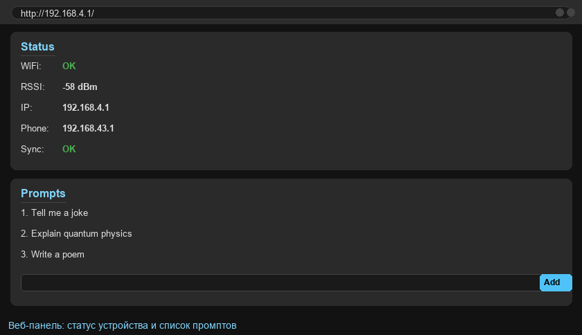
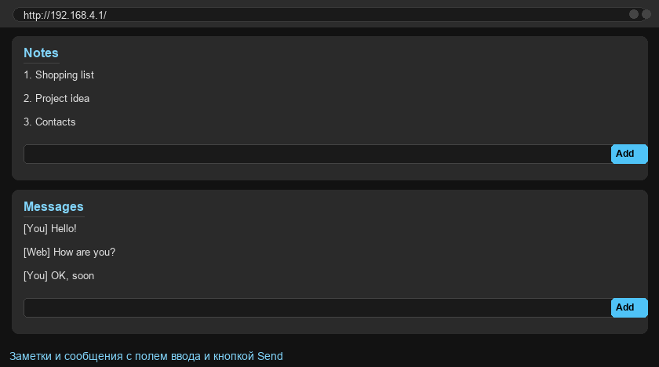
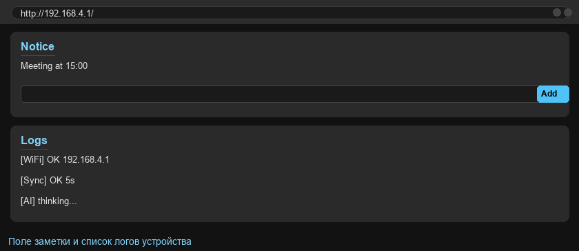

# ESP8266 AI Terminal

Умный OLED-терминал на базе **ESP8266** с играми, AI-чатом, часами, калькулятором, заметками и сообщениями. Устройством управляют всего две кнопки, а стартовый экран показывает то, что вы выбираете в боковом меню — как маленький наручный компьютер.

Проект построен из трёх частей:

- **Прошивка ESP8266** (`8.6.ino`) — весь код терминала: интерфейс, игры, синхронизация, веб-сервер.
- **Control Panel** (`control_panel/app.py`) — веб-панель для ПК, которая хранит данные всех устройств и даёт **AI-ответы через Ollama**.
- **Phone Relay** (`phone_relay/relay_server.py`) — ретранслятор для телефона (Android/Termux), который связывает ESP с Control Panel через интернет.

```
┌────────────┐   WiFi (точка доступа телефона)   ┌────────────┐   интернет   ┌────────────────┐
│   ESP8266   │ ◀──────────────────────────────▶ │  Phone     │ ◀──────────▶ │ Control Panel  │
│  (8.6.ino)  │            /api/state            │  Relay     │  (Tailscale) │  (app.py)      │
└────────────┘                                    └────────────┘              └────────────────┘
                                                   port 8000                    Flask + Ollama
```

> **Коротко о работе.** ESP подключается к точке доступа телефона и общается с приложением-ретранслятором по локальной сети. Тот, в свою очередь, пересылает данные во внешнюю панель Control Panel и обратно. AI-промпт, заданный на ESP, доходит до Control Panel, та отправляет его локальной нейросети Ollama и возвращает ответ. ESP показывает ответ на экране.

---

## Возможности

- **AI-чат** — задайте промпт на экране, ответ приходит от локальной нейросети (Ollama) и отображается с пролистыванием страниц.
- **Главное меню** — 8 пунктов, порядок которых можно менять: AI Chat, Time, Notice, Maps, Calc, Msg, Notes, Games.
- **Часы** — время с синхронизацией по NTP (нужен интернет).
- **Калькулятор** — базовые операции (`+ - * /`) с вводом двумя кнопками.
- **Сообщения и заметки** — посимвольный ввод, готовые шаблоны, история, синхронизация с панелью.
- **Три игры**: Pong (теннис против ИИ), Dodger (уклонение), Dino (бегущий динозавр).
- **Заметка на экране (Notice)** — оставить себе напоминание.
- **Загружаемые карты** — список и просмотр бинарных карт (демо-механизм).
- **Встроенная веб-панель** — управление промптами, заметками и сообщениями прямо в браузере.
- **Режим сна** — гасит экран и экономит батарею (см. раздел «Использование батареи»).
- **Настройки**: порядок меню, яркость, уведомления, сон, синхронизация, подключение к WiFi.

---

## Возможности не поддержены / ограничения

- Цветовой OLED не поддерживается — используется монохромный SSD1306 128×64.
- Клавиатура ввода — только латиница (A–Z) и цифры, кириллица на самом устройстве не набирается.
- Ответ AI обрезается и делится на страницы по 5 строк из-за размера экрана.
- Для AI нужен работающий Ollama и сеть до него через ретранслятор.

---

## Требования к железу

| Компонент | Рекомендация |
|---|---|
| **ESP8266** | NodeMCU или Wemos D1 mini, 4 МБ flash |
| **OLED** | SSD1306, 128×64, 4-проводный **SPI** |
| **Кнопки** | 2 шт., замыкание на GND (используется INPUT_PULLUP) |
| **Питание** | 3.3 В (через USB или от аккумулятора через LDO) |

### Подключение OLED по SPI

| Пин SSD1306 | Пин ESP8266 | GPIO |
|---|---|---|
| SCL (SCK) | D5 | GPIO14 |
| SDA (MOSI) | D7 | GPIO13 |
| CS | D8 | GPIO15 |
| DC | D2 | GPIO4 |
| RST | D0 | GPIO16 |
| VCC | 3.3V | — |
| GND | GND | — |

> Всегда сверяйте распиновку с платой, которую используете: некоторые NodeMCU-клоны имеют отличия.

---

## Прошивка ESP8266 (8.6.ino)

1. Установите **Arduino IDE** (1.8+ или 2.x).
2. В менеджере плат добавьте пакет **ESP8266**:
   - File → Preferences → *Additional Boards Manager URLs*:
     `http://arduino.esp8266.com/stable/package_esp8266com_index.json`
   - Tools → Board → Boards Manager → найдите **esp8266** → Install.
3. Через **Library Manager** (Tools → Manage Libraries) установите библиотеки:
   - `U8g2`
   - `ArduinoJson`
   - `ESP8266WiFi`, `ESP8266HTTPClient`, `ESP8266WebServer` (идут с пакетом ESP8266)
4. Откройте `8.6.ino` и **впишите свои данные** в блок в начале файла — сейчас там стоят заглушки:

```cpp
const char* PHONE_RELAY_FALLBACK = "192.168.0.100";  // IP ретранслятора (телефона)
const char* FALLBACK_SSID = "YOUR_WIFI_SSID";        // запасная домашняя WiFi
const char* FALLBACK_PASS = "";                      // пароль (пусто = открытая сеть)
```

   Заполните как минимум `FALLBACK_SSID`/`FALLBACK_PASS`. Поле `PHONE_RELAY_FALLBACK` используется, когда ESP не может определить адрес телефона автоматически.
5. Выберите плату: **Tools → Board → NodeMCU 1.0 (ESP-12E Module)**, flash size **4MB**.
6. Подключите плату и нажмите **Upload**.

> Прошивка использует **SPIFFS (LittleFS)** для хранения настроек, промптов, заметок и сообщений. Данные сохраняются между перезагрузками и появляются при первом запуске по умолчанию — ваши правки не затираются.

---

## Управление кнопками

| Действие | Кнопка |
|---|---|
| Листать / переключать пункт | **NEXT** (короткий тап) |
| Выбрать / войти в пункт | **SEND** (короткий тап) |
| Доп. действие (например, отправить AI-промпт) | **NEXT** (удержать) |
| Назад / вернуться в меню | **SEND** (удержать) |
| Войти в настройки (из меню) | **SEND** (удержать) |
| Вкл./выкл. режим сна | **NEXT + SEND** (удержать вместе) |

**В игре Dino:** `SEND` — прыжок, `NEXT` — пригнуться, удержание — пауза.
**В калькуляторе:** `NEXT` — смена цифры/знака, `SEND` — ввод, удержание `NEXT` — «=», удержание `SEND` — сброс и выход.

---

## Использование батареи

Питание от одного-двух **Li-Po / Li-Ion аккумуляторов** через LDO-стабилизатор 3.3 В либо через USB-повербанк. Ниже — ориентировочная оценка времени работы при разной ёмкости.

**Предположения:**
- среднее потребление **≈ 75 мА** с включённым экраном;
- потребление в режиме сна **≈ 10 мА** (экран выключен, WiFi засыпает);
- «смешанный сценарий» — ≈ 3 часа с экраном и 21 час в сне из каждых 24 ч;
- «активный режим» — экран постоянно включён;
- «сон» — экран почти всегда выключен.

| Ёмкость | Активный режим, ~75 мА | Сон, ~10 мА | Смешанный, ~18 мА* |
|---|---|---|---|
| **300 мАч** | ~4 ч | ~30 ч | ~16 ч |
| **400 мАч** | ~5 ч | ~40 ч | ~22 ч |
| **500 мАч** | ~6.5 ч | ~50 ч | ~27 ч |
| **1000 мАч** | ~13 ч | ~100 ч (~4 суток) | ~55 ч (~2.3 суток) |

\* Смешанный сценарий: экран включён ~3 ч/сутки, остальное время — сон.

**Способы продлить работу:**
- включите **Режим сна** (Settings → Sleep) в меню;
- уменьшите **яркость** (Settings → Bright) — потребление дисплея заметно падает;
- используйте **аккумулятор 1000 мАч**, если устройство работает постоянно.

---

## Control Panel (control_panel/app.py)

Веб-панель хранит данные всех устройств в JSON-файлах и отдаёт **AI-ответы через локальный Ollama**.

### Требования

- Python 3.8+
- Установленный и запущенный [**Ollama**](https://ollama.com)
- Скачанная модель (например, `deepseek-r1:1.5b`, используемая по умолчанию)

### Установка и запуск

```bash
cd control_panel
pip install -r requirements.txt
python app.py
```

Панель поднимется на `http://0.0.0.0:5000`. Откройте её в браузере на том же компьютере.

### Что нужно настроить перед запуском

В файле `control_panel/app.py`:

```python
OLLAMA_MODEL = "deepseek-r1:1.5b"   # модель, которую скачали в Ollama
SYSTEM_PROMPT = "You must answer ONLY in English. Be brief and clear."
API_TOKEN = "CHANGE_ME_RANDOM_SECRET_TOKEN"   # задайте свою секретную строку
```

`API_TOKEN` — общий для всех частей системы. Один и тот же токен должен стоять в `app.py`, `relay_server.py` и в `templates/index.html`.

### Доступ из интернета

Чтобы Control Panel была доступна с телефона через ретранслятор, откройте к ней сетевой доступ. Проще всего — туннель Tailscale:

```bash
tailscale funnel 5000
```

Подставьте полученный публичный адрес в `relay_server.py` (поле `PUBLIC_CONTROL_PANEL`).

---

## Phone Relay (phone_relay/relay_server.py)

Ретранслятор запускается на **Android-телефоне в Termux** и связывает ESP с Control Panel по интернету. Работает как локальный мост: принимает данные от ESP по WiFi (порт 8000), пересылает их в Control Panel и наоборот, а также отдаёт простой веб-интерфейс для правки данных с телефона.

### Настройка перед запуском

В `phone_relay/relay_server.py`:

```python
PUBLIC_CONTROL_PANEL = "https://YOUR_PUBLIC_CONTROL_PANEL_URL"
API_TOKEN = "CHANGE_ME_RANDOM_SECRET_TOKEN"
```

- `PUBLIC_CONTROL_PANEL` — адрес, по которому доступна Control Panel (см. выше);
- `API_TOKEN` — тот же, что и в `app.py`.

### Запуск в Termux

```bash
cd phone_relay
chmod +x start_relay.sh
./start_relay.sh        # установит зависимости и запустит relay_server.py
```

Либо вручную:

```bash
cd phone_relay
pip install -r requirements.txt
python relay_server.py
```

После запуска локальный веб-интерфейс будет доступен на телефоне по адресу, который скрипт выведет в консоль (обычно `http://192.168.43.1:8000`).

---

## Веб-панель ESP (встроенная)

Помимо внешней панели на ПК, у самого ESP есть мини-веб-интерфейс — он зашит прямо в прошивку и работает с любого браузера. Открывается он как обычная веб-страница на самом устройстве и собирает все данные терминала в одну тёмную dashboard-страницу.

### Как открыть

1. Узнайте IP терминала (меню **Stats** на экране, строка `IP:`).
2. Откройте в браузере `http://<IP>/` (по умолчанию — `http://192.168.4.1/`).

Никакой установки не требуется: страница и все данные уже внутри прошивки. Обновления интерфейса подгружаются автоматически каждые 3 секунды.

### Что на странице

Веб-панель состоит из шести секций, которые собираются в одну страницу:

| Секция | Назначение |
|---|---|
| **Status** | Текущее состояние устройства: статус WiFi, уровень сигнала (RSSI), IP-адрес терминала, адрес ретранслятора и результат последней синхронизации (OK/FAIL). |
| **Prompts** | Список AI-промптов со счётчиком. Каждый можно отредактировать (кнопка **Save**) или удалить (кнопка **Del**). Поле **New prompt** + кнопка **Add** — добавить новый промпт (до 60 символов). |
| **Notes** | Заметки устройства. Каждую можно переименовать (Save) или удалить (Del). Кнопка **Clear** очищает все заметки разом. |
| **Messages** | Журнал сообщений устройства. Метки `[Y]` — сообщения, отправленные с терминала, `[W]` — пришедшие с веб-панели. Поле + кнопка **Send** — отправить сообщение на устройство. |
| **Notice** | Текст заметки, который отображается на экране терминала (пункт меню **Notice**). Поле + кнопка **Set** — сохранить и показать на OLED. |
| **Logs** | Системный журнал прошивки (подключения к WiFi, синхронизации, ошибки). Живой список, обновляется автоматически. |

### Скриншоты интерфейса

Тёмная тема и голубые кнопки повторяют стиль самого OLED-терминала. Ниже — как выглядит панель в браузере.

**Информация о статусе и список промптов:**



**Заметки и история сообщений:**



**Заметка на экран (Notice) и системные логи:**



> Эти изображения сгенерированы скриптом [`simulator_web_ui.py`](#симулятор-веб-панели-simulator_web_uipy) и хранятся в папке `screenshots/web/`. Реальная панель выглядит так же, но с фактическими данными вашего устройства.

### Быстрая навигация по данным

Все изменения, которые вы делаете в веб-панели (промпты, заметки, сообщения, заметка на экран), на следующем цикле синхронизации передаются на терминал и отображаются на OLED — обычно в течение нескольких секунд.

## Синхронизация данных

ESP периодически (каждые ~5 секунд) отправляет в ретранслятор свои данные — промпты, заметки, сообщения — и забирает обновлённые версии обратно. Это позволяет править данные и из веб-панели, и с телефона.

Управляется синхронизация в меню **Settings → Sync**. Статус последней синхронизации виден в меню **Stats**.

---

## Симулятор экрана (simulator_oled.py)

Приложение **пока не нужно железо, чтобы увидеть интерфейс**. Скрипт `simulator_oled.py` рисует точную копию экрана OLED 128×64 для всех ключевых состояний прошивки и сохраняет их в PNG в папку **`screenshots/`**.

Удобно для: документации, дизайна меню, демонстрации, проверки вёрстки без сборки прошивки.

### Запуск

Нужен **Python 3.8+** и библиотека **Pillow**.

```bash
pip install pillow
python simulator_oled.py
```

Скрипт создаст (или перезапишет) папку `screenshots/` и сгенерирует 20 изображений:

| Файл | Что показывает |
|---|---|
| `01_splash.png` | Заставка при включении + прогресс-бар |
| `02_menu.png` | Главное меню |
| `03_stats.png` | Статус: WiFi, RSSI, IP, синхронизация |
| `04_ai_list.png` | Список AI-промптов |
| `05_thinking.png` | «AI думает» |
| `06_response.png` | Ответ AI, страница из нескольких |
| `07_time.png` | Часы |
| `08_notice.png` | Заметка |
| `09_maps.png` | Список карт |
| `10_settings.png` | Настройки |
| `11_wifi_list.png` | Сканирование WiFi-сетей |
| `12_calc.png` | Калькулятор |
| `13_chat.png` | Сообщения |
| `14_notes.png` | Заметки |
| `15_games.png` | Меню игр |
| `16_pong.png` | Игра Pong |
| `17_dino.png` | Игра Dino |
| `18_dodger.png` | Игра Dodger |
| `19_sleep.png` | Подтверждение режима сна |
| `20_web_ui.png` | Схема веб-панели |

### Как настроить под себя

- **Масштаб картинки.** В начале файла переменная `SCALE` управляет размером вывода: чем больше, тем крупнее изображение на выходе.
- **Содержимое экрана.** Каждое состояние описано отдельной функцией вроде `s_menu()` — редактируйте текст и цифры прямо там, чтобы подогнать под свою прошивку.
- **Добавить своё состояние.** Напишите функцию по образцу существующих и добавьте её имя в список `ALL` внизу файла.
- **Шрифт.** По умолчанию используется встроенный пиксельный шрифт Pillow. Если нужно — подключите свой TTF (в проекте уже есть заготовка с системным шрифтом для подписей).

---

## Симулятор веб-панели (simulator_web_ui.py)

Этот скрипт рисует вид **встроенной веб-панели ESP** так, как она открывается в браузере: тёмная тема с голубыми кнопками, адресная строка и секции Status / Prompts / Notes / Messages / Notice / Logs. Готовые изображения показаны в разделе [«Веб-панель ESP (встроенная)»](#веб-панель-esp-встроенная) и сохраняются в папку **`screenshots/web/`**.

### Запуск

```bash
pip install pillow
python simulator_web_ui.py
```

Скрипт сгенерирует три PNG-файла:

| Файл | Что показывает |
|---|---|
| `01_dashboard.png` | Статус устройства + список промптов |
| `02_notes_messages.png` | Заметки и история сообщений |
| `03_notice_logs.png` | Заметка на экран (Notice) и системные логи |

### Как настроить под себя

- **Содержимое секций.** Каждая секция задаётся вызовом `page.card("Заголовок", [(kind, text), ...])`. Строки вида `("item", "...")` — обычный текст, `("status", ("Имя", "Значение"))` — пара «ключ — значение». Изменяйте их, чтобы интерфейс соответствовал вашим данным.
- **Тема оформления.** Палитра (цвета фона, кнопок, текста) задаётся константами в начале файла — скорректируйте их, если меняли стиль прошивки.
- **Добавить свою страницу.** Напишите функцию по образцу `main()` — создайте `Page()`, добавьте нужные `card(...)` и вызовите `save("имя.png", "подпись")`.

---

## Безопасность

Перед публикацией/развёртыванием обязательно:

1. Задайте **свой** `API_TOKEN` — общий для `app.py`, `relay_server.py` и `templates/index.html`. Не используйте токен-заглушку из репозитория.
2. Впишите свои `FALLBACK_SSID`/`FALLBACK_PASS` в `8.6.ino` и укажите свой `PHONE_RELAY_FALLBACK`.
3. Укажите свой `PUBLIC_CONTROL_PANEL` в `relay_server.py`.
4. Не коммитьте runtime-файлы (`control_data/`, `relay_data/`) — они уже исключены через `.gitignore`, т.к. содержат личные данные устройств.

> Токены и пароли из репозитория — это заглушки. Настоящие креды должны задаваться локально, а не попадать в git.

---

## Структура репозитория

```
.
├── 8.6.ino                    # прошивка ESP8266
├── README.md                  # этот файл (RU)
├── README.en.md               # документация на английском
├── LICENSE                    # лицензия MIT
├── simulator_oled.py          # симулятор OLED-экрана (screenshots/*.png)
├── simulator_web_ui.py        # симулятор веб-панели (screenshots/web/*.png)
├── .gitignore                 # исключает личные runtime-данные
├── control_panel/
│   ├── app.py                 # веб-панель + AI через Ollama
│   ├── requirements.txt       # зависимости панели
│   └── templates/
│       └── index.html         # веб-интерфейс панели
└── phone_relay/
    ├── relay_server.py        # ретранслятор для Android (Termux)
    ├── requirements.txt       # зависимости ретранслятора
    └── start_relay.sh         # скрипт запуска в Termux
```

---

## Часто задаваемые вопросы (FAQ)

**Не могу подключить ESP к WiFi.**
Проверьте, что в прошивку вписаны правильные `FALLBACK_SSID`/`FALLBACK_PASS`. Устройство само поднимает точку доступа телефона, поэтому на телефоне должен быть включён режим хот-спота/точки доступа.

**Экран пустой / не включается.**
Проверьте распиновку SPI (`SCL`, `SDA`, `CS`, `DC`, `RST`) и питание 3.3 В. Убедитесь, что выбрали правильную модель платы в Arduino IDE.

**AI не отвечает / долго думает.**
Убедитесь, что запущен Ollama, скачана модель, а в `app.py` указано её точное имя. Ответ по сети через ретранслятор может занимать до минуты-двух.

**Промпты сбрасываются на стандартные.**
Версии до исправления сбрасывали промпты при каждой загрузке. Сейчас промпты и порядок меню сохраняются в SPIFFS и обновляются только при первом запуске или когда данных ещё нет.

**Как сбросить все данные устройства?**
Стереть flash-память платы (Erase Flash) и перепрошить — после первого запуска заполнятся стандартные промпты.

---

## Известные особенности

- Длинные тексты (AI-ответы, заметки) переносятся по словам и листаются страницами по 5 строк — это ограничение маленького экрана.
- Клавиатура устройства вводит только латиницу и цифры, поэтому сообщения, написанные на ESP, латинские. Кириллицу можно отправлять из веб-панелей.
- Сторонние игровые спрайты (динозавр, кактусы) нарисованы вручную в виде битмапов — при желании их можно заменить.

---

## Лицензия

MIT — свободно использовать, изменять и распространять. См. файл [LICENSE](LICENSE).

---

*Сделано для обучения и личного использования. Форкайте и дорабатывайте!*